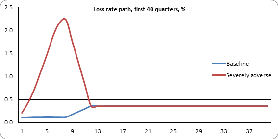
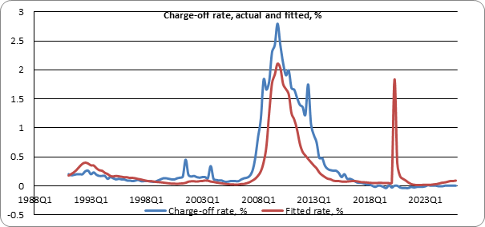

# cecl-credit-loss-model

[](https://github.com/aakashbansalgit/cecl-credit-loss-model/actions/workflows/tests.yml)

An Excel CECL allowance for a $1bn mortgage book, with the loss model estimated inside the workbook and driven by the Federal Reserve's 2026 stress-test scenarios, checked against an independent Python model.



CECL (ASC 326) makes a bank book the losses it expects over a loan's whole life on the day it makes the loan. `cecl_allowance.xlsx` does this the way many banks do for a homogeneous pool, top down. The loss-rate model is a `LINEST` regression on the History sheet, so it re-fits if the data change. The forecast uses the Fed's published scenarios, and the book runs off quarter by quarter. There are no macros: every number outside the Inputs and data sheets is a formula.

## How the allowance is built

1. **A loss-rate model.** The quarterly net charge-off rate on single-family mortgages at US banks, 1991 to 2025, is regressed on the unemployment rate and the change in house prices over the previous three years. It is fitted in logs, ln(max(rate, 0) + 0.02), so losses can sit near zero when owners have equity and rise steeply when prices fall. A straight-line model cannot do both, and in testing it put today's loss rate at 0.28% against an actual zero.
2. **A loss-rate path.** For the reasonable and supportable period, eight quarters by default, the model runs on one of the Fed's 2026 scenarios. Over the next four quarters the rate moves in a straight line to its long-run average, and it stays there for the rest of the book's life.
3. **The book.** $1bn of 6.5% mortgages with 28 years left, prepaying at 8% CPR. Each quarter loses its balance times the loss rate, then pays scheduled principal and prepays. The allowance is the sum of those losses under each scenario, weighted 60% baseline and 40% severely adverse.

## The loss-rate model



| | Coefficient | t-stat |
|---|---|---|
| Constant | -3.504 | -8.4 |
| Unemployment rate, % | 0.352 | 5.8 |
| House price change over 12 quarters, % | -0.0295 | -4.7 |

R squared is 0.54 on 140 quarters. Each point of unemployment raises the loss rate by about 42%, and a 10% fall in house prices over three years raises it by about 34%.

It catches the shape of 2008 but not its height, 2.1% at the end of 2009 against an actual 2.8%. And it gets 2020 badly wrong. Unemployment jumped to 13%, so the model put the loss rate at 1.8%, but actual charge-offs stayed at zero: forbearance kept borrowers out of foreclosure while house prices rose. That miss is the case for the management overlay that real CECL models carry on top of the regression.

## Results

| | Baseline | Severely adverse | Weighted 60/40 |
|---|---|---|---|
| Allowance | $25.3m | $51.5m | $35.8m |
| Share of the book | 2.53% | 5.15% | 3.58% |
| Losses after quarter 12 | 84% | 40% | 59% |

In the severely adverse scenario, unemployment peaks at 10.0% and house prices fall 30% from the end of 2025. Over the Fed's nine-quarter window, the model loses 3.0% of the book under that scenario. The Fed's own projection for first-lien mortgages at the 32 banks it tested is 1.5%. The gap is expected: the model learns from 2008, when bank mortgage books held far weaker loans than the post-2010 books the Fed is projecting.

## What drives the number

**The long-run rate, more than the scenario.** 84% of the baseline allowance comes after quarter 12, when the economic forecast no longer matters and only the long-run loss rate does. That rate is the 1991 to 2025 average, 0.36% a year. Leave out 2008 to 2013 and the average is 0.11%, and the baseline allowance falls from $25.3m to $9.2m. So the choice of history window moves the baseline allowance by $16m, more than half the $26m gap between the two Fed scenarios. This is a known feature of CECL, and the Allowance sheet has a table of the allowance against the long-run rate to show it.

**The forecast and reversion periods.** A second table reprices the weighted allowance for forecast periods of 4 to 12 quarters and reversion periods of 1 to 12. It ranges from $30.1m to $39.9m. Going from 4 to 8 quarters takes in the worst of the severely adverse path, which peaks in quarter 8. Beyond that the path is already recovering, so a longer forecast adds little, and with a long reversion it slightly lowers the allowance.

Both tables are Excel data tables, so each cell is a full rerun of the workbook.

## How it is checked

`cecl.py` rebuilds everything in Python, written separately from the workbook. `tests/test_workbook.py` reads the values Excel calculated and checks:

- the `LINEST` coefficients against a least-squares fit, and both long-run averages
- the loss rates under both scenarios, quarter by quarter, and the nine-quarter losses
- every quarter of the book under both scenarios: rate, balance, loss, scheduled principal and prepayment
- the allowance under each scenario and weighted
- all 20 cells of the forecast-by-reversion table and all 18 of the long-run table, each a full rerun in Python

The tests read the saved workbook with openpyxl, so they run on GitHub without Excel.

## Limits

The model is fitted to the whole banking system's charge-offs, so it describes an average bank book, not a prime one. Losses are charge-offs, taken in the quarter they happen, with no separate delinquency, default and recovery steps, and the allowance is not discounted. There is no qualitative overlay, which 2020 shows a real model needs.

## Data

- Bank net charge-offs on single-family mortgages: FRED series CORSFRMACBS
- Unemployment and house prices, history and scenarios: the Federal Reserve's 2026 supervisory stress test files
- The Fed's projected first-lien mortgage losses: its 2026 public stress test results

All are in `data/`.

## Running it

```
pip install -r requirements.txt
python -m pytest tests          # checks the workbook against cecl.py
python cecl.py                  # the allowance in Python
python build_workbook.py        # rebuilds the workbook; needs Excel on Windows
```
